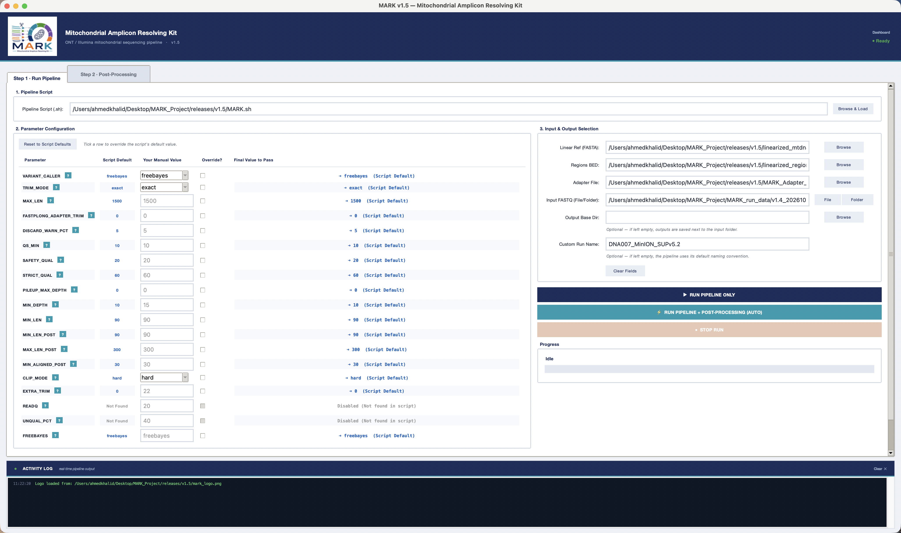

# MARK: Mitochondrial Amplicon Resolving Kit


**MARK** is a cross-platform bioinformatics suite designed to analyze targeted mitochondrial DNA (mtDNA) control-region data. It is specifically engineered to resolve overlapping amplicons, such as those generated by the **Promega PowerSeq™ CRM Nested System**.

MARK adapts Illumina-based chemistry workflows for both **Illumina** and **Oxford Nanopore Technologies (ONT)** sequencing platforms.

---

## Overview

MARK includes an automated Python GUI dashboard:



```bash
MARKLaunch.py
```

The dashboard drives two split-track shell pipelines:

| Pipeline | Platform | Input Type |
|---|---|---|
| `MARK.sh` | Oxford Nanopore Technologies | Long-read FASTQ data |
| `MARK-I.sh` | Illumina | Paired-end FASTQ data |

Both pipelines map reads to a **linearized mitochondrial reference** and split the analysis into two directly comparable tracks:

1. **Baseline Track**  
   Uses unmodified alignments.

2. **Trimmed Track**  
   Exact amplicon trimming: a read is kept only if it is one whole PCR product (the forward and reverse primer of the same amplicon). After alignment, the primer bases at each product end are hard-clipped (CIGAR H; `CLIP_MODE=soft` keeps them as soft clips, as up to v1.4.2), so that only insert bases reach variant calling.

---

## Key Features

- **GUI Dashboard**  
  `MARKLaunch.py` provides a unified interface for configuring variables, launching pipelines, and running post-processing tools.

- **Cross-Platform Support**  
  Handles both ONT long-read data and Illumina short-read paired-end data.

- **Diagnostic Split-Track Analysis**  
  Performs independent variant calling, annotation, and depth tracking for both the baseline and trimmed tracks. This allows direct comparison of how amplicon-boundary enforcement affects variant detection.

- **Amplicon-Aware Processing**  
  Uses a maximum-overlap rule to assign reads to their most appropriate amplicon and applies boundary-aware trimming to reduce overlap-related artifacts.

- **Automated Post-Processing**  
  Includes tools to convert linearized VCF coordinates back to standard circular rCRS positions and clean BAM headers for downstream review.

- **Choice of Variant Caller (v1.5)**  
  `VARIANT_CALLER` selects `freebayes` (the default), `bcftools`, or `both`. With `both`, freebayes makes the calls and
  bcftools runs on the same final BAM through the same filters; MARK then writes a combined VCF tagging every variant as
  called by both callers, freebayes only or bcftools only, and a plain-text comparison per library.

- **Heteroplasmy Report (v1.6)**  
  The calls come from a one-copy model, which reports the majority base. To show mixtures, freebayes is also run on
  the final BAM in pooled-continuous mode, and every allele at `HET_MIN_AF` (5% by default) or more of the reads, at
  depth `MIN_DEPTH` or more, is listed as point (PHP) or length (LHP) heteroplasmy in
  `<library>_trimmed_heteroplasmy.vcf` (fraction in `INFO/HET_AF`) and in a HETEROPLASMY section of the sample report,
  with homopolymer regions and excluded sites marked. These are for review, not calls.

- **Debug-Friendly Outputs**  
  Produces multiple VCF layers, including raw, quality-filtered, SNP-only, cleaned, and homopolymer-focused outputs, allowing detailed review of variant behavior across processing stages.

---

## Installation

MARK can be installed through Conda when the package is available, or run directly from the GitHub source.

**Tested Installation:**

Since v1.4 MARK calls variants with **freebayes**. Its bioconda builds cannot share an environment with the validated tool versions on Linux and Apple Silicon (they need older htslib and libdeflate), so it is installed in a second, small environment named `mark_fb`. MARK uses `freebayes` from your `PATH` if it is there, otherwise it finds the `mark_fb` environment by itself; you can also point to any copy with `FREEBAYES=/path/to/freebayes`. With `VARIANT_CALLER=bcftools` (v1.5) freebayes is not needed for the calls; the heteroplasmy report (v1.6) still uses it when it is installed and is skipped, with a note in the log, when it is not.

```bash
conda create -n mark_env -c conda-forge -c bioconda python=3.10 biopython "fastp>=1.3.7" "fastplong>=0.7.1" "minimap2>=2.31" "bwa-mem2>=2.3" "bcftools>=1.24" "cutadapt>=5.2" "fastqc>=0.12.1" "samtools>=1.24" -y
# freebayes (the variant caller since v1.4) goes in its own environment; MARK finds it there by itself
conda create -n mark_fb -c conda-forge -c bioconda freebayes=1.3.10 -y
conda activate mark_env
git clone https://github.com/DP-Genome/MARK.git
cd MARK
python3 MARKLaunch.py
```

---

## Usage

**MARK** can be driven via the interactive GUI dashboard or run entirely from the command line for automation and advanced usage.

### Using the GUI Dashboard

Launch the interactive dashboard. After installing via Anaconda, `MARKLaunch.py` is on your `PATH` and can be run directly:

```bash
MARKLaunch.py
```

When running from a cloned source folder, launch it with Python from inside that folder:

```bash
python3 MARKLaunch.py
```

### Using the Command Line

`MARK.sh` (nanopore) and `MARK-I.sh` (Illumina) are standalone bash scripts, so MARK runs without the dashboard,
for example on a server, an HPC cluster or in a workflow manager. A complete command-line run has two steps:

```bash
# 1. Run the pipeline. Settings are environment variables placed before the command.
VARIANT_CALLER=both RUN_NAME=run1 OUTPUT_DIR=/data/out MARK.sh /data/fastq_folder

# 2. Post-process the run folder: VCFs to rCRS coordinates, cleaned BAMs, Final_Pipeline_Results/ (no GUI needed)
MARKLaunch.py --postprocess /data/out/run1          # from a source folder: python3 MARKLaunch.py --postprocess ...
```

**Inputs.** `MARK.sh` takes one FASTQ (`.fastq` or `.fastq.gz`) or a folder of them, one library per file.
`MARK-I.sh` takes an R1 FASTQ, whose R2 it finds by replacing `_R1`/`.R1` with `_R2`/`.R2`, or a folder of such pairs.

**Settings.** Anything not set uses its default. Some examples:

```bash
MARK.sh /data/fastqs                                         # all defaults (freebayes)
VARIANT_CALLER=bcftools MARK.sh /data/fastqs                 # bcftools instead of freebayes
VARIANT_CALLER=both MARK-I.sh /data/illumina                 # freebayes calls, compared with bcftools
threads=16 MIN_DEPTH=20 STRICT_QUAL=80 MARK-I.sh /data/illumina
CLIP_MODE=soft TRIM_MODE=standard MARK.sh /data/fastqs
FREEBAYES=/opt/freebayes/bin/freebayes MARK.sh /data/fastqs
```

`MARK.sh --help`, `MARK-I.sh --help` and `MARKLaunch.py --help` list every option. The full list is in
[Settings reference](#settings-reference) below.

**Data files.** Each script uses the reference (`linearized_mtdna.fasta`), the regions BED, the primer and insert BEDs
and the adapter list that ship in its own folder, so it can be started from any directory. To use other files, pass
them explicitly, e.g. `ref=/path/ref.fasta regions_bed=/path/regions.bed ADAPTER_FILE=/path/adapters.txt MARK.sh in/`.

**Post-processing options.** `MARKLaunch.py --postprocess RUN_FOLDER [--linear-ref FASTA] [--rcrs FASTA]` runs the same
four steps as the dashboard's Step 2 tab and AUTO button. By default it uses the `linearized_mtdna.fasta` and
`rCRS.fasta` that ship beside it.

### Settings reference

The same settings appear in the dashboard's parameter table (each with a **?** help button) and as environment
variables on the command line. Default values are shown.

**Variant calling** (both pipelines)

| Setting | Default | What it does |
|---|---|---|
| `VARIANT_CALLER` | `freebayes` | `freebayes`: realigns reads over each candidate region and judges whole haplotypes. `bcftools`: `mpileup` + `call`, position by position (as up to v1.2.10); freebayes need not be installed. `both`: freebayes makes the calls; bcftools also runs on the same final BAM through the same filters, and MARK writes `<library>_trimmed_snps_both_callers.vcf` (each variant tagged `CALLERS=both`, `freebayes_only` or `bcftools_only`) and `<library>_caller_comparison.txt` (each caller's verdict, QUAL and depth). |
| `FREEBAYES` | `freebayes` | The freebayes program: from `PATH`, else a conda environment named `mark_fb`, or a full path. |
| `MIN_DEPTH` | `10` | Minimum read depth for a variant. Amplicons with a position below it are also listed in `WARNINGS.txt`. |
| `SAFETY_QUAL` | `20` | First filter: calls need QUAL above this (the review VCFs). |
| `STRICT_QUAL` | `60` | Calls: single-nucleotide variants need QUAL above this (`*_snps.vcf`, `*_clean.vcf`). |
| `PILEUP_MAX_DEPTH` | `0` | Most reads the caller reads at one position; `0` = no limit. |
| `BASEQ_MIN`, `MAPQ_MIN` | `20`, `20` | Minimum base and mapping quality used in calling. |
| `HET_MIN_AF` | `0.05` | Heteroplasmy report (v1.6): every allele at this fraction of the reads or more (and at most 1 minus it), at depth `MIN_DEPTH` or more, from freebayes in pooled-continuous mode on the final BAM, in `<library>_trimmed_heteroplasmy.vcf` and the sample report. `0` turns it off. Needs freebayes, also with `VARIANT_CALLER=bcftools`. |

**Trimming and clipping** (both pipelines)

| Setting | Default | What it does |
|---|---|---|
| `TRIM_MODE` | `exact` | `exact`: keep a read only if it is one whole amplicon product (forward and reverse primer of the same amplicon), cut at its own primers. `standard`: cut adapter-list sequences wherever found. |
| `CLIP_MODE` | `hard` | Primer bases after alignment: `hard` removes them from the read (CIGAR `H`); `soft` keeps them as soft clips. The calls are identical. |
| `PRIMER_ERR` | ONT `0.15`, Illumina `0.10` | Error rate allowed in a primer match (exact mode). |
| `PRIMER_MIN_OVERLAP` | ONT `18`, Illumina `3` | Minimum primer match length (exact mode). |
| `EXTRA_TRIM` | `0` | Extra bases trimmed from both read ends (nanopore; Illumina in standard mode). |
| `FASTPLONG_ADAPTER_TRIM` | `0` | Nanopore, exact mode: `1` lets fastplong auto-trim adapters (off, because it also cut primer bases). |
| `CUTADAPT_ERR`, `CUTADAPT_OVL` | `0.10`, `5` | Adapter match error rate and minimum overlap (standard mode). |

**Read filters**

| Setting | Default | Pipeline | What it does |
|---|---|---|---|
| `MAX_LEN` | `1500` | nanopore | Reads longer than this are removed first (length safeguard). |
| `QS_MIN` | `10` | nanopore | Minimum mean read quality (the `qs` tag in the FASTQ header). |
| `READQ` | `20` | Illumina | A base counts as good quality at this Phred score or above (fastp). |
| `UNQUAL_PCT` | `40` | Illumina | A pair is dropped if more than this % of a read's bases are below `READQ`. |
| `N_BASE_LIMIT` | `5` | Illumina | A pair is dropped if a read has more N bases than this. |
| `MERGE2_CUT_Q`, `MERGE2_CUT_WINDOW`, `MERGE2_MIN_LEN` | `20`, `4`, `30` | Illumina | Second merge pass for pairs that did not merge: 3′ quality trimming threshold, window and shortest read kept. |
| `MIN_LEN` | `90` | both | Nanopore: shortest read after adapter trimming (standard mode). Illumina: shortest merged fragment. |
| `MIN_LEN_POST`, `MAX_LEN_POST` | `90`, `300` | both | Length window for products after trimming (amplicons are 144–237 bp). |
| `MIN_ALIGNED_POST` | `30` | both | Template bases a read must align after primer clipping, or it is removed with its mate. |

**Warnings** (never stop a run; listed in `WARNINGS.txt`)

| Setting | Default | What it does |
|---|---|---|
| `PRIMER_WARN_PCT` | ONT `10`, Illumina `25` | Flag a library if fewer than this % of its reads carry a primer pair of one amplicon. |
| `ALIGNED_WARN_PCT`, `ALIGNED_WARN_MIN` | `20`, `10` | Flag an amplicon if primer clipping removes this % of its fragments, and at least this many. |
| `PRIMER_DIAG_READS` | `20000` | Rejected reads kept per step for review (`<library>_primer_rejects_review*.fastq`). |

**Files and run** (both pipelines)

| Setting | Default | What it does |
|---|---|---|
| `threads` | `8` | CPU threads. |
| `ref` | `linearized_mtdna.fasta` | Linearised reference. |
| `regions_bed` | `linearized_regions.bed` | Homopolymer regions and excluded sites. |
| `PRIMERS_BED`, `INSERTS_BED` | `CRM_Nested_primers_empirical.bed`, `CRM_Nested_inserts.bed` | Primer and amplicon-insert coordinates. |
| `ADAPTER_FILE` | `MARK_Adapter_List_ONT.txt` / `MARK_Adapter_List_Illumina.txt` | Adapter list. |
| `MINIMAP_EXTRA` / `BWA_EXTRA` | exact mode: `--end-bonus 15` / empty | Extra aligner options (nanopore: minimap2; Illumina: bwa-mem2). |
| `RUN_NAME` | `<pipeline>_<input>_<timestamp>_output` | Name of the output folder. |
| `OUTPUT_DIR` | beside the input | Where the output folder is created. |
| `CUTADAPT_STALL_SECS` | `600` | Seconds without cutadapt output before it is rerun single-core. |

---

## Step 1: Run the Pipeline

From the main dashboard tab:

1. Select the appropriate pipeline script:
   - `MARK.sh` for ONT data
   - `MARK-I.sh` for Illumina paired-end data

2. Adjust pipeline parameters, including:
   - The variant caller (`VARIANT_CALLER`: freebayes, bcftools or both)
   - Quality thresholds
   - Minimum and maximum read length settings
   - Depth thresholds
   - Trimming variables

3. Select the required input files and folders:
   - Input FASTQ folder
   - Reference FASTA file
   - Amplicon or region BED file
   - Adapter/primer list

4. Click **Run Pipeline**.

---

## Step 2: Post-Processing

The second dashboard tab is used to finalize and organize the analysis outputs.

Post-processing includes:

1. **Organize Raw Output**  
   Sorts BAM and VCF files into their respective folders.

2. **Linear VCF Correction**  
   Converts variants called on the linearized mitochondrial reference back to standard circular rCRS coordinates.

3. **BAM Cleaning**  
   Cleans BAM headers and removes intermediate processing tags where required.

4. **Final Collection**  
   Packages the cleaned and corrected files into a final delivery folder.

The **Auto** button on the first tab can be used to run the selected pipeline and all four post-processing steps sequentially.
Without the dashboard, `MARKLaunch.py --postprocess RUN_FOLDER` runs the same four steps (see [Using the Command Line](#using-the-command-line)).

---

## Pipeline Workflow

MARK follows the general workflow below:

1. **Maximum Length Filtering**  
   Removes anomalous reads before core processing.

2. **Preprocessing**  
   Performs platform-specific preprocessing:
   - Illumina read merging where applicable
   - Quality filtering
   - Adapter/primer trimming using `cutadapt`. Illumina uses a 3′ pass (`-a`) followed by a
     5′ pass (`-g`); ONT uses a single position-aware pass (`-b --times 2`), because these
     libraries carry the adapter at both ends of the molecule and `-a` alone deletes any read
     whose adapter is matched at the 5′ end

3. **Alignment**  
   Aligns reads against a linearized mitochondrial reference:
   - ONT: `minimap2`
   - Illumina: `bwa-mem2`

4. **Track Splitting**  
   Generates two analysis tracks:
   - Baseline BAM
   - Trimmed BAM, in which each read is identified by its own primer ends: a read end matching
     a known PCR product terminus has that product's primer removed, and everything between the
     primers is kept, whichever amplicons it spans

5. **Variant Calling and Annotation**  
   Uses `freebayes` by default (since v1.4) for one-copy variant calling, after local realignment of the reads over
   each region. Since v1.5, `VARIANT_CALLER=bcftools` uses `bcftools mpileup` + `call` instead (as up to v1.2.10), and
   `VARIANT_CALLER=both` runs both on the final BAM and compares them (freebayes still makes the calls). `bcftools`
   then splits, filters and annotates the calls, including:
   - Homopolymer regions
   - Excluded sites (known artefact positions, e.g. rCRS 310, 16182 and 16183)
   - Other predefined regions of interest

6. **VCF Export**  
   Produces distinct VCF outputs for debugging, comparison, and final interpretation, including:
   - Raw VCF
   - Quality-filtered VCF
   - SNP-only VCF
   - Cleaned VCF
   - Homopolymer-only VCF

---

## Output Structure

Each run creates a timestamped output folder (e.g. `MARK_<input>_<timestamp>_output/`), with one subfolder per sample. The post-processing steps then organize and finalize the results.

Typical outputs include:

```text
MARK_<input>_<timestamp>_output/
├── <sample>/                  # per-sample intermediates, QC, logs, and VCFs
├── sorted_bams/               # collected baseline/trimmed sorted BAMs
├── vcfs/                      # collected raw and filtered VCFs
├── run_summary.txt            # settings, and reads kept at every step, per library
├── WARNINGS.txt               # only when a library or amplicon was flagged (read this first)
└── Final_Pipeline_Results/
    ├── README.txt             # what every folder holds
    ├── WARNINGS.txt, run_summary.txt
    ├── corrected_vcfs/        # the calls: <library>_trimmed_clean / _trimmed_snps _corrected.vcf, rCRS coordinates
    ├── cleaned_bams/          # the final BAM of each library (primer bases hard-clipped; CLIP_MODE=soft keeps them)
    ├── sample_reports/        # <library>_final_sample_report.tsv: calls with heteroplasmy and depth; variants in forensic notation
    │                          #   (ISFG/EMPOP: e.g. 152C, 315.1C, 523del 524del), the VCF record beside each indel
    │                          # VARIANT_CALLER=both: <library>_caller_comparison.txt (what each caller called), and in
    │                          #   corrected_vcfs/ the bcftools call sets and <library>_trimmed_snps_both_callers_corrected.vcf
    │                          # v1.6: the report's HETEROPLASMY section, and in corrected_vcfs/
    │                          #   <library>_trimmed_heteroplasmy_corrected.vcf (every allele >= HET_MIN_AF; for review)
    ├── qc/                    # per-amplicon depth; fragments removed after alignment
    ├── reference/             # the linearised reference the BAMs are aligned to, for IGV
    └── review/                # every other VCF, and the review ("baseline") BAM
```

Exact folder names may vary depending on the run timestamp and selected pipeline.

---

## Main Scripts

| Script | Purpose |
|---|---|
| `MARKLaunch.py` | GUI dashboard for running pipelines and post-processing |
| `MARK.sh` | ONT mitochondrial amplicon pipeline |
| `MARK-I.sh` | Illumina mitochondrial amplicon pipeline |

---

## Notes

The baseline and trimmed tracks should be reviewed together when assessing variant behavior, especially in difficult regions such as homopolymers, amplicon overlaps, and primer-proximal positions.

An ONT test input fastq has been provided to test the pipeline with 'Test_M.fastq'.

---

## Recommended Output for Interpretation

The corrected VCFs in `Final_Pipeline_Results/corrected_vcfs/` (`<library>_trimmed_clean_corrected.vcf`, and `_trimmed_snps_corrected.vcf` with homopolymer sites) are the main files intended for downstream comparison and review. They are in rCRS coordinates (`NC_012920.1`), sorted by position. Check `WARNINGS.txt` first: it lists any library or amplicon whose results need care, for example an amplicon below the calling depth. Intermediate VCFs are retained under `review/` for transparency and troubleshooting.

---

## Citation
If you use MARK, please cite this repository:
Omar, Ahmed K A. MARK: Mitochondrial Amplicon Resolving Kit. GitHub repository. https://github.com/DP-Genome/MARK
